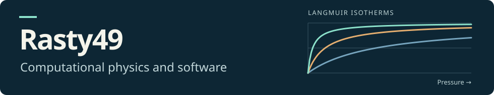

I like turning equations into plots I can experiment with. I also build tools for problems I run into myself. Webmail MCP started when I wanted to use my university inbox from ChatGPT.

### Selected projects

| Project | What you can do with it |
| --- | --- |
| [Webmail MCP](https://github.com/rasty49/webmail-mcp) | Search a university inbox from ChatGPT desktop or Claude Code, draft a reply, and review it locally before sending. |
| [Gas Adsorption Plots](https://github.com/rasty49/gas-adsorption-plots) | Adjust the temperature and partition function to see how much of a surface a gas covers in the Langmuir model. |
| [SIR Model Notebook](https://github.com/rasty49/Numerical-Physics/blob/main/SIR%20model.ipynb) | Follow the equations that move a population between susceptible, infectious, and recovered groups in a Jupyter notebook. |

I’m interested in collaborating on quantum optics simulations, especially models of light in cavities.
